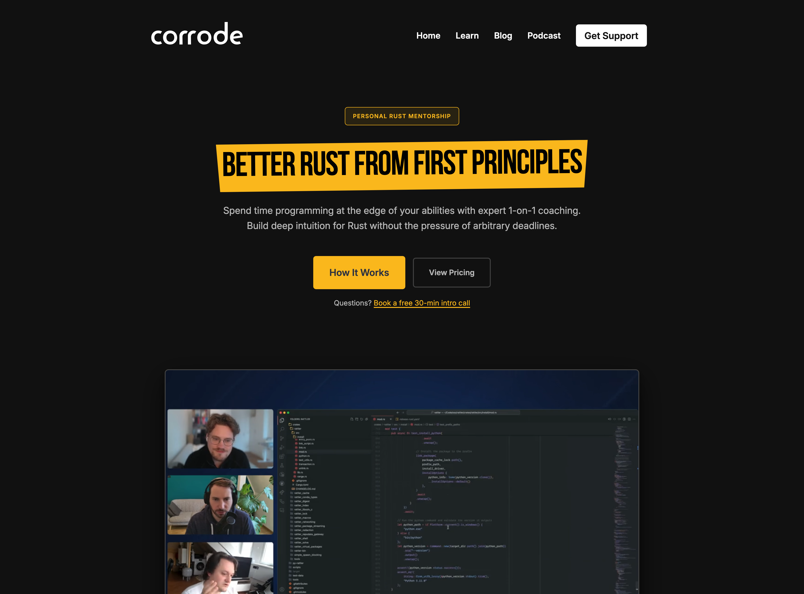
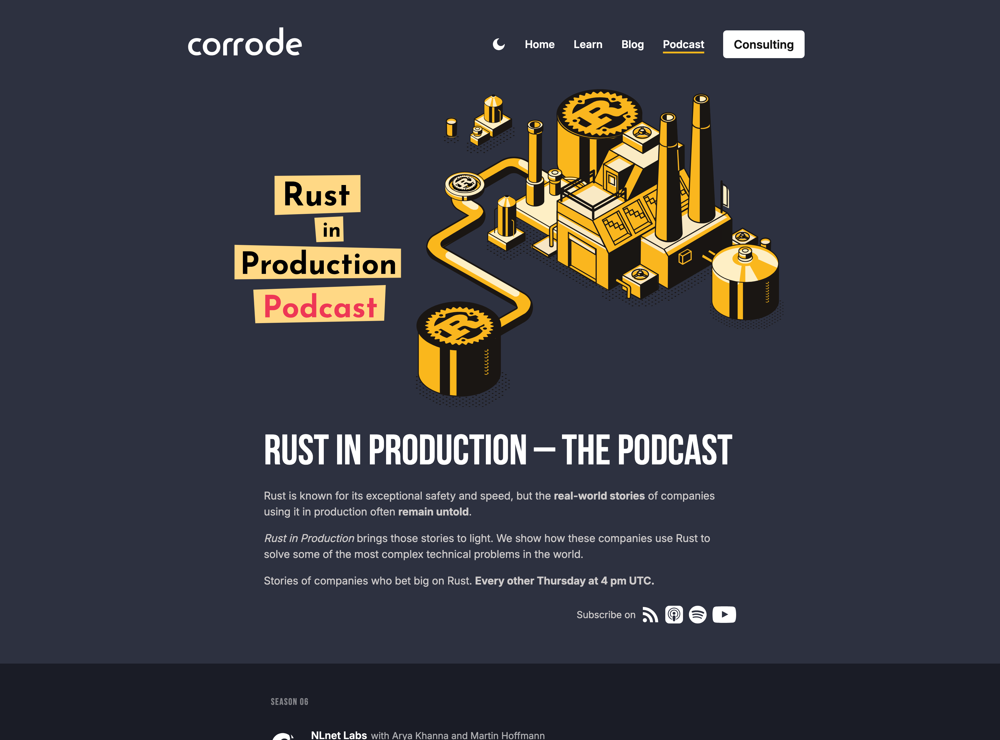

<AccentStripe />

# Writing Better Rust

## Fully Using the Type System

A refactoring workshop

Matthias Endler · Corrode

---
layout: about-me
helloMsg: Hello!
name: Matthias Endler
imageSrc: /me.png
position: left
job: Rust Consultant
line1: Host of Rust in Production
social1: "@mre"
social2: corrode.dev
---

---

# About you

Let's get acquainted. 

### 👋 Who
- Name and where you're from
- What do you do day to day?
- What are your main programming languages?

### 🦀 Rust
- How long have you been writing Rust?
- What do you use it for? (work, side project, learning)

### 🔥 Wildcard
- What do you want to take away from this workshop?
- Favourite crate of the moment

---
src: ./pages/00_motivation.md
---

---
src: ./pages/00_schedule.md
---

---
src: ./pages/00_how_it_works.md
---

---
src: ./pages/00_arc_overview.md
---

---
layout: section
---

<AccentStripe />

Phase 1 of 6

# Warm-ups

Types, signatures, simple matches.

The point is to get talking. Start with the existing signatures;
then compare API alternatives and the tradeoffs they introduce.

Exercises 01–05

---
src: ./pages/01_is_yes.md
---

---
src: ./pages/02_starts_with_uppercase.md
---

---
src: ./pages/03_better_match.md
---

---
src: ./pages/04_even_numbers.md
---

---
src: ./pages/05_truncate_string.md
---

---
layout: section
---

<AccentStripe />

Phase 2 of 6

# `Option` · `Result` · `?`

The idioms that show up in almost every Rust file.

Exercises 06–12

---
src: ./pages/06_path.md
---

---
src: ./pages/07_nesting.md
---

---
src: ./pages/08_optional_values.md
---

---
src: ./pages/09_parse_ints.md
---

---
src: ./pages/10_floor.md
---

---
src: ./pages/11_error_handling.md
---

---
src: ./pages/12_parse_port.md
---

---
layout: section
---

<AccentStripe />

Phase 3 of 6

# Aggregations & counting

Iterator chains, explicit loops, and consuming a recursive list.

Exercises 13–19

---
src: ./pages/13_dedup_runs.md
---

---
src: ./pages/14_excluded_path.md
---

---
src: ./pages/15_spell_check.md
---

---
src: ./pages/16_room_occupancy.md
---

---
src: ./pages/17_text_stats.md
---

---
src: ./pages/18_mode.md
---

---
src: ./pages/19_list_sum.md
---

---
layout: section
---

<AccentStripe />

Phase 4 of 6

# Strings, parsing & iterators

Reach for the standard library before hand-rolling a loop.

Exercises 20–25

---
src: ./pages/20_trim_log_line.md
---

---
src: ./pages/21_parse_srt_timestamp.md
---

---
src: ./pages/22_iterators.md
---

---
src: ./pages/23_transformer.md
---

---
src: ./pages/24_fun_strings_ext.md
---

---
src: ./pages/25_quicksort.md
---

---
layout: section
---

<AccentStripe />

Phase 5 of 6

# Domain modeling

Here you can change the API from the first solution.
Choose types and methods, then update callers and tests.

Exercises 26–35

---
src: ./pages/26_rooms.md
---

---
src: ./pages/27_iban_prefix_check.md
---

---
src: ./pages/28_http_response_router.md
---

---
src: ./pages/29_config_loader.md
---

---
src: ./pages/30_buffer_policy.md
---

---
src: ./pages/31_typed_ids.md
---

---
src: ./pages/32_validation_feedback.md
---

---
src: ./pages/33_secret_token.md
---

---
src: ./pages/34_config_typestate.md
---

---
src: ./pages/35_friends.md
---

---
layout: section
---

<AccentStripe />

Phase 6 of 6

# Capstone

Lastly, two larger bonus problems.

Exercises 36–37

---
src: ./pages/36_env_file_parser.md
---

---
src: ./pages/37_mini_redis.md
---

---
layout: center
---

# Want more of this?

## [corrode.dev/pro](https://corrode.dev/pro)

Personalized Rust code reviews and 1:1 mentorship from experienced Rust engineers.

Bring your own code. Get focused feedback, idiomatic refactors, and answers to the questions your team can't.

---
layout: center
---

# Podcast 

## [corrode.dev/podcast](https://corrode.dev/podcast)

A podcast about how Rust is used in the real world. We talk to engineers from all kinds of companies about their Rust codebases, the problems they solve with Rust, and the lessons they've learned along the way.

---
layout: center
---

# That's a wrap!

Thank you.

Questions or your own code you want to discuss?

corrode.dev · @matthiasendler

